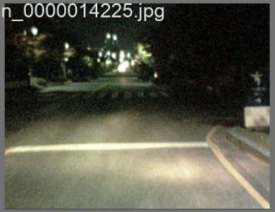
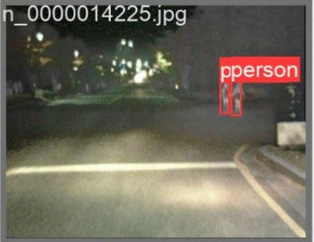
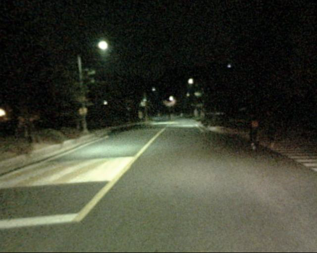
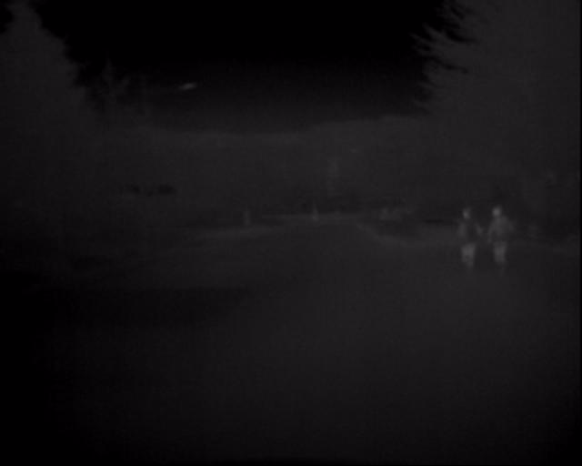
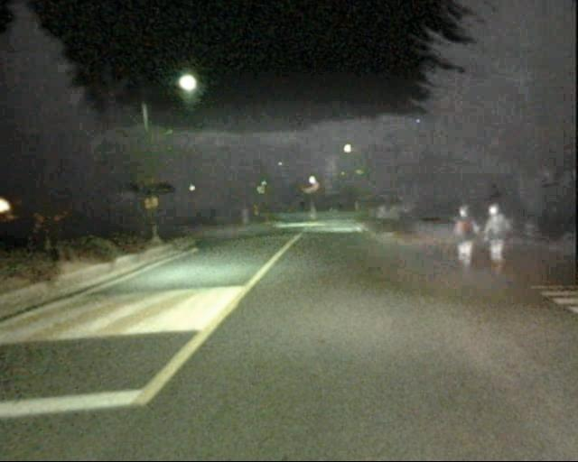
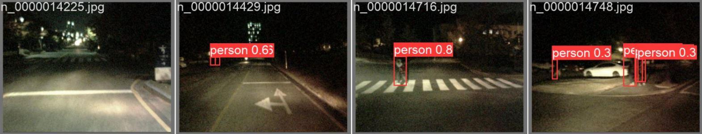
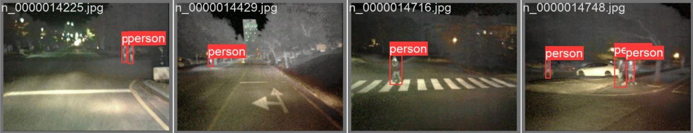
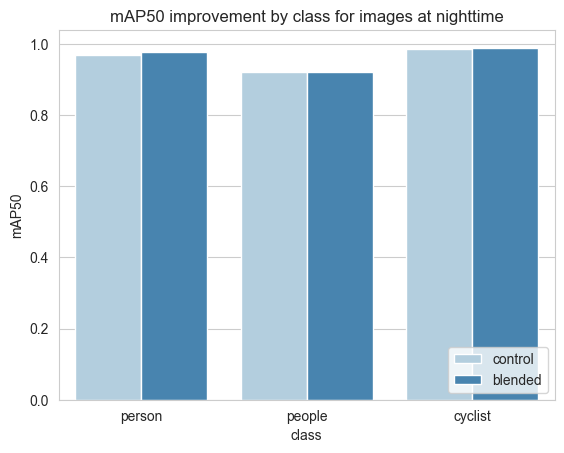
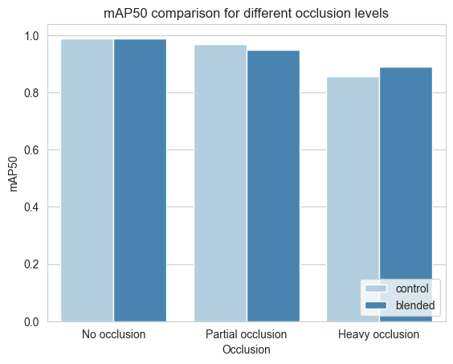

# Multispectral pedestrian detection after dark

Comparing RGB and thermal-blended inputs with YOLOv8.

| Regular RGB detection | Multispectral (RGB + IR) detection |
|---|---|
|  |  |

**Two pedestrians missed in the RGB example are detected in the blended example.** These are the original predictions shown in Figure 8 of the [research report](docs/RMAI_report_yolov8.pdf), with the first scene extracted from each row. Boxes and labels are preserved as recorded. This illustrates a favorable case; the aggregate results below show where the method helps and where it loses performance.

### What does a multispectral image look like?

A separate nighttime scene from Figure 3 of the report shows how the inputs combine:

| Visible camera (RGB) | Thermal camera (IR) | Blended input (RGB + IR) |
|---|---|---|
|  |  |  |

The pedestrians on the right are difficult to see in the visible image. Thermal information makes them stand out in the blended input while retaining the road scene's visible colors. These input examples have no detection boxes.

<details>
<summary>View all four nighttime detection examples from the report</summary>

**Regular RGB predictions**



**Multispectral RGB + IR predictions, in the same scene order**



Original Figure 8 images, extracted from the report. Click an image to inspect the bounding boxes at full resolution.

</details>

**Can thermal images help a compact object detector find pedestrians in low light?** This project investigates that question by comparing visible-light (RGB) images with RGB + infrared blends on the KAIST multispectral pedestrian dataset.

Built for *Research Methods for Artificial Intelligence* at the **Open University of the Netherlands**, the project covers image fusion, annotation conversion, model training in Azure ML, and evaluation by lighting condition and pedestrian occlusion.

[Results](#what-we-found) · [Explore the project](#explore-the-project) · [Run the experiment](#run-the-experiment) · [Research report](docs/RMAI_report_yolov8.pdf)

> **The finding:** infrared blending offers modest benefits at night and under heavy occlusion. Its value depends on the scene: daytime performance and stricter localization metrics expose tradeoffs that an overall score can hide.

## The experiment

Two YOLOv8 nano models are compared using corresponding images and the same dataset split:

| | RGB control | RGB + IR blended |
|---|---|---|
| Input | Original visible-light image | Visible image enriched with thermal lightness information |
| Model | Pretrained YOLOv8n | Pretrained YOLOv8n |
| Classes | `person`, `people`, `cyclist` | `person`, `people`, `cyclist` |
| Reported training | 60 epochs, batch size 32 | 60 epochs, batch size 32 |

The report describes **95,328 synchronized color-thermal image pairs**, each at 640 × 512 pixels. After filtering for images containing `person` or `people`, **39,039 image pairs** remain:

| Training | Validation | Test |
|---:|---:|---:|
| 24,984 | 6,247 | 7,808 |

The split is shared across both input variants. Evaluation includes precision, recall, precision-recall curves, mAP@0.50, and mAP@0.50:0.95, with separate daytime, nighttime, and occlusion analyses.

### How the images are fused

The report's fusion method converts visible and thermal images into CIELAB, normalizes their lightness channels, combines the lightness information, and converts the result back to a three-channel image. The implementation in [`rgb_ir_img_blender.py`](image_convert_test/rgb_ir_img_blender.py) uses the pixelwise maximum of the two lightness channels while retaining the visible image's color channels. This lets the experiment use a standard YOLOv8n architecture.

## What we found

**Nighttime detection improves modestly; thermal blending is not a universal improvement.** The report finds slightly better nighttime precision-recall curves for `person` and `people`, while daytime curves favor RGB alone. Brighter blended daytime images can reduce contrast through overexposure.

Selected results from the committed evaluation CSVs, shown as percentages:

| Evaluation slice | Metric | RGB control | RGB + IR | Change |
|---|---|---:|---:|---:|
| Night, `person` | AP@0.50 | 96.97% | 97.66% | +0.69 pp |
| Night, all classes | mAP@0.50 | 95.89% | 96.23% | +0.34 pp |
| Night, all classes | mAP@0.50:0.95 | 68.29% | 67.30% | -0.99 pp |
| Heavy occlusion, `person` | AP@0.50 | 85.77% | 88.88% | +3.11 pp |
| Heavy occlusion, `person` | AP@0.50:0.95 | 54.47% | 55.09% | +0.62 pp |

Sources: [night RGB](runs/detect/night_control/mean_results.csv), [night blended](runs/detect/night_blended/mean_results.csv), [heavy occlusion RGB](runs/detect/occ_2_control/mean_results.csv), [heavy occlusion blended](runs/detect/occ_2_blended/mean_results.csv). Changes are percentage points, calculated before rounding. AP is reported for an individual class; mAP averages across classes.

**Heavy occlusion is the clearest favorable case.** The report finds gains in both AP metrics for heavily occluded pedestrians, while no and partial occlusion show equal or better performance for the RGB control. The occlusion analysis combines daytime and nighttime images.

| Nighttime performance by class | Performance by occlusion level |
|---|---|
|  |  |

These are exploratory results from the recorded experiment. The report does not establish statistical significance or a general improvement across conditions. The lower nighttime mAP@0.50:0.95 also shows that gains at IoU 0.50 do not imply better bounding-box localization across stricter thresholds.

## Explore the project

You can inspect the saved results without downloading the dataset or retraining a model.

| Resource | What it contains |
|---|---|
| [Research report](docs/RMAI_report_yolov8.pdf) | Research questions, methodology, results, discussion, and references |
| [`figures/`](figures/) | RGB-versus-blended comparisons, PR and F1 curves, and occlusion plots |
| [`runs/detect/`](runs/detect/) | Evaluation CSVs, confusion matrices, curves, and sample predictions by condition |
| [`azure/validation-metrics/`](azure/validation-metrics/) | Training/validation logs for both 60-epoch experiments |
| [`last_control.pt`](last_control.pt) / [`last_blended.pt`](last_blended.pt) | Saved model checkpoints for the two input variants |
| [`yolov8n.pt`](yolov8n.pt) | Base model checkpoint |

### Processing and evaluation workflow

| Stage | File |
|---|---|
| Blend visible and thermal images using CIELAB lightness | [`image_convert_test/rgb_ir_img_blender.py`](image_convert_test/rgb_ir_img_blender.py) |
| Explore an earlier image-blending approach | [`1.create_multispectral_images.ipynb`](1.create_multispectral_images.ipynb) |
| Convert KAIST's VOC-like annotations into COCO | [`2.covert_VOC_to_COCO.ipynb`](2.covert_VOC_to_COCO.ipynb) |
| Convert COCO annotations into YOLO labels | [`3.convert_COCO_to_YOLO.ipynb`](3.convert_COCO_to_YOLO.ipynb) |
| Create corresponding train, validation, and test folders | [`4.move_files_to_DOTA_structure.ipynb`](4.move_files_to_DOTA_structure.ipynb) |
| Explore local training / submit Azure ML training | [`5.train_model_local.ipynb`](5.train_model_local.ipynb) / [`6.train_model_azure.py`](6.train_model_azure.py) |
| Evaluate checkpoints and export metrics | [`7.generate_test_results.ipynb`](7.generate_test_results.ipynb) |
| Compare results and generate visualizations | [`8.extra_visualisations.ipynb`](8.extra_visualisations.ipynb) |

## Run the experiment

This repository preserves the research code and outputs. The notebooks contain machine-specific paths and intermediate-data assumptions, so reproducing the full experiment requires adapting them to your environment.

### 1. Set up Python

Use a Python virtual environment. The following installs the libraries imported by the local workflow; package versions are not pinned in the original project.

```bash
python -m venv .venv
# Windows PowerShell
.venv\Scripts\Activate.ps1
# macOS / Linux: source .venv/bin/activate
python -m pip install ultralytics opencv-python numpy pillow pandas scikit-learn matplotlib seaborn tqdm jupyter
```

The original Azure container definition and its additional dependencies are in [`azure/environment/`](azure/environment/).

### 2. Prepare KAIST data

Download the images and annotations from the [KAIST Multispectral Pedestrian Detection Benchmark](https://soonminhwang.github.io/rgbt-ped-detection/). The dataset is not included in this repository.

1. Keep corresponding `visible` and `lwir` images in the KAIST directory structure. Generate the report-style blends with:

   ```bash
   python image_convert_test/rgb_ir_img_blender.py --directory path/to/kaist/images
   ```

   The script writes images into matching `blended` folders.

2. Adapt the paths in notebooks 2-4, then convert annotations and create matching dataset splits. Review the expected intermediate folders in each notebook before running it; some cells rename or copy files. Notebook 1 uses an earlier averaging approach, so use the CIELAB script above for the report's method.
3. Update `path:` in [`config_control.yaml`](config_control.yaml) and [`config_blended.yaml`](config_blended.yaml). Each dataset root should contain:

   ```text
   DOTA_CONTROL/                 # same layout for DOTA_BLENDED/
   ├── images/
   │   ├── train/
   │   ├── val/
   │   └── test/
   └── labels/
       ├── train/
       ├── val/
       └── test/
   ```

### 3. Train or evaluate

Once the datasets and YAML paths are ready, these commands express the reported training settings for fresh local runs:

```bash
yolo detect train data=config_control.yaml model=yolov8n.pt batch=32 epochs=60 imgsz=640 seed=42 name=control
yolo detect train data=config_blended.yaml model=yolov8n.pt batch=32 epochs=60 imgsz=640 seed=42 name=blended
```

To evaluate the included checkpoints on your prepared test sets:

```bash
yolo detect val data=config_control.yaml model=last_control.pt split=test
yolo detect val data=config_blended.yaml model=last_blended.pt split=test
```

Notebook 5 is a one-epoch local example and references `config.yaml`; select the appropriate existing configuration before using it. Notebook 7 contains the metric-export workflow; adjust its model and dataset paths for each evaluation slice.

For **Azure ML**, the training script expects a local, gitignored `config.ini` with `[AZURE]` keys `SubscriptionId`, `ResourceGroupName`, and `WorkspaceName`. It also references workspace-specific data/model assets and an environment version. Adapt those references before execution. The committed script registers a checkpoint and submits a **10-epoch continuation**, whereas the report describes **60 total epochs**; it also creates compute resources in your Azure workspace.

### Reproduction notes

The repository includes exploratory code alongside the final outputs. In particular, `entities.py` contains a positional argument after keyword arguments in `VOC2COCO.convert`, which must be corrected before the annotation-conversion notebook can import it. Dependencies are unpinned, and some intermediate preparation steps require manual alignment. The commands above are a guide to the workflow, not a claim that the original experiment has been rerun on a clean environment.

## Authors and research context

**Joachim Verschelde and Johan van Nispen**
Open University of the Netherlands · Research Methods for Artificial Intelligence

Report: *The effect of low light conditions on pedestrian detection using YOLOv8*. See the [full report](docs/RMAI_report_yolov8.pdf) for the complete literature references and discussion.

The experiment builds on the **KAIST Multispectral Pedestrian Detection Benchmark** by Hwang et al. (CVPR 2015) and **Ultralytics YOLOv8**.

## License

The repository code is available under the [MIT License](LICENSE). KAIST data and third-party models remain subject to their respective terms.
